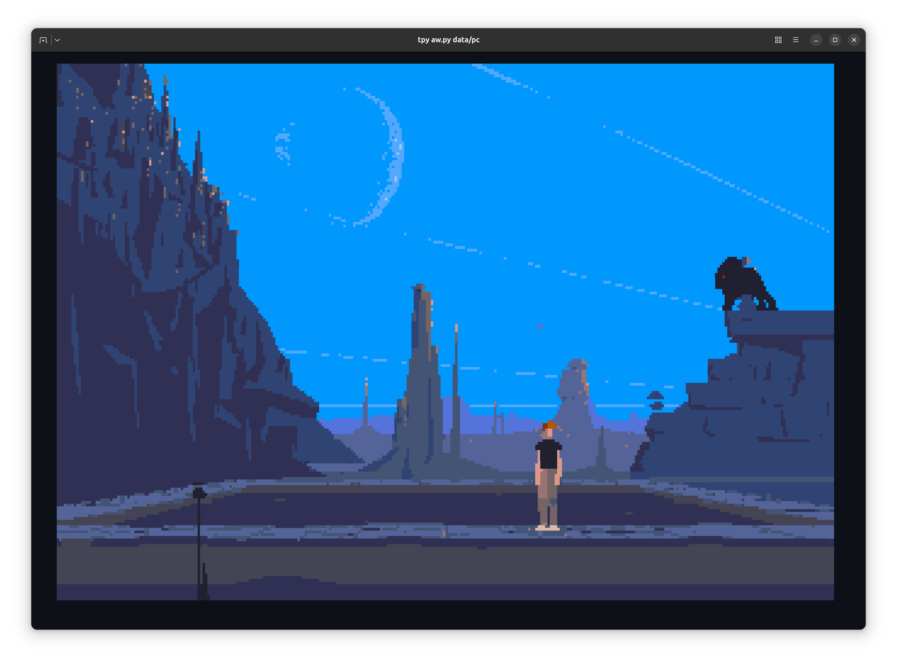

# tpy-another-world

The Another World (Out of This World) engine, ported to TurboPython: the
bytecode VM, the resource loader with its ByteKiller decompressor, and the
polygon rasterizer. The picture is drawn in the terminal with block glyphs
and 24-bit color, and the game is played with the keyboard.



*The DOS release in Ghostty, drawn with octant glyphs (Ghostty's default; `tpy aw.py data/pc`).*

## Getting the game

You can get the game on GOG:
[Another World 20th Anniversary Edition](https://www.gog.com/en/game/another_world_20th_anniversary_edition),
which also includes the Amiga version. No game data is included here; if
you play it with this port, please buy it and support its makers.

The game reads three releases; point `DIR` on the command line at one of
them:

- **20th Anniversary Edition** (GOG): the install directory, or its
  `game/` directory. The game runs its original 320x200 pictures and the
  English text of the edition, and its original sound or, with
  `--remastered-audio`, its remastered one; the HD pictures are not used.
- **DOS**: the directory with `MEMLIST.BIN` and `BANK01` to `BANK0D`.
- **Amiga**, which the GOG edition includes as a zip of two floppy images:
  the directory with the two `.adf` files from the unzipped archive, or
  with the `bankNN` files on them.

## Run

The game runs on [TurboPython](https://tpy-lang.org), which compiles it to
C++ on the first run. It needs TurboPython 0.7, which is not released yet;
until it is, TurboPython is installed from its repository:

```bash
uv tool install git+https://github.com/trozen/tpy-lang   # TurboPython's master
tpy aw.py DIR                                            # DIR holds the game data
```

The released TurboPython 0.6.2 (`uv tool install tpy-lang`) runs the game as
of the `tpy-0.6.2` tag (`git checkout tpy-0.6.2`), without sound and music.

In Ghostty the game draws its sharpest picture (`-8`) by default; for other
terminals see [Terminal](#terminal). The keys are below; `tpy aw.py`
without arguments prints them with all the options.

## Keys

| Key | Action |
|---|---|
| left, right | walk; run with space held |
| up | jump |
| down | crouch |
| space, enter | action: kick, shoot, or run with an arrow; skips the intro |
| c | the password screen, to start at a checkpoint by its code |
| p | pause (the 20th Anniversary Edition's music recordings play on) |
| letters, backspace, enter | type a code on the password screen, and check it |
| Ctrl-C | quit, printing the code of the checkpoint reached in a level |

## Terminal

For the best experience, run the game in Ghostty.

Use a terminal with the
[kitty keyboard protocol](https://sw.kovidgoyal.net/kitty/keyboard-protocol/):
Ghostty, kitty, WezTerm, foot or Alacritty. Only such terminals report key
releases, and the game needs to know how long a key is held; in others,
such as GNOME Terminal, a key counts as held while it repeats, so a tap
lasts about half a second. The terminal also needs 24-bit color; the
picture is scaled to fit the window.

Sound goes to the sound server through `pw-play` (PipeWire), `paplay`
(PulseAudio), `aplay` (ALSA) or SoX's `play`, the first of them that
works; without one the game plays silently and says so when it quits. On
macOS that is `play`: `brew install sox`.

Use `-8` where the terminal can show it: it draws 2x4 pixels a cell, the
sharpest picture, with octant characters (Unicode 16) that most fonts lack;
`-6` needs sextants (Unicode 13). Ghostty draws these characters itself,
whatever the font. Without an option, the game uses `-8` in Ghostty, which
it detects, and `-2`, which works with any font, elsewhere.

On macOS, play in Ghostty (`brew install --cask ghostty`). The fonts macOS
ships lack octants, and with one installed that has them, iTerm2 still
draws `-8` with stripes between the rows.

## Render modes

The image is scaled to fit the terminal and centered. The mode picks how
many pixels one terminal cell shows: `-2`, `-4`, `-6` and `-8` by that count,
or `-r` (`--render`) by name. Without one, the game uses `-8` in Ghostty,
which it detects, and `-2` elsewhere.

| Option | Pixels per cell | Notes |
|---|---|---|
| `-2`, `-r half` | 1x2 | half blocks; every cell exact; the default outside Ghostty |
| `-4`, `-r quad` | 2x2 | quadrants |
| `-6`, `-r sextant` | 2x3 | needs sextants (Unicode 13) in the font, or Ghostty |
| `-8`, `-r octant` | 2x4 | needs octants (Unicode 16) in the font, or Ghostty; the default in Ghostty |
| `-r braille` | 2x4 | dots; one-color cells are drawn solid |

A cell shows two colors; a cell with more gets the pair that represents its
pixels best. The frame is first reduced to the grid the terminal fits,
keeping the most common color of each block of pixels.

## Ideas

- A smooth mode. The game runs at about 10 frames a second, and its
  animation is hand-drawn key poses. Frames in between could glide moved
  shapes and morph one pose into the next, shown during the wait the
  original already has before each frame, so they would add no delay. Going
  further, the scripts could run at 30 steps a second, every third step
  kept equal to the original's.
- Save states.
- A search of the bytecode for code and text the game never reaches.

How the engine is checked, its headless runs and its source layout:
[docs/DEVELOPMENT.md](docs/DEVELOPMENT.md).

## Benchmark

TPy runs the benchmark 25x faster than CPython 3.14, 2.7x faster than
PyPy and 1.5x faster than Shedskin.

The engine runs under TPy and under other ways of running the same
Python source. A batch is three scenes of the DOS release, 1460 timed
frames. Each runner runs 5 processes of 10 batches; a process counts the
median of its batches 4-10, and the table gives the median over the
processes. All runs are on one pinned CPU of a Ryzen 9 5950X, and every
run's end-state digests are checked.

| Runner | ms per batch | vs TPy (slower) |
|---|---:|---:|
| TPy | 34.7 ms | 1.0x |
| CPython 3.14 | 870 ms | 25.1x |
| PyPy 3.11 | 93.5 ms | 2.7x |
| Nuitka (CPython 3.14) | 1265 ms | 36.5x |
| mypyc (CPython 3.14) | 203 ms | 5.8x |
| Shedskin -O3 | 52.6 ms | 1.5x |

The DOS release's files are not part of the GOG edition;
docs/DEVELOPMENT.md lists them with their sizes and SHA-256. The
runners, the full results, how they are reproduced, and the caveats:
[docs/DEVELOPMENT.md, Benchmark](docs/DEVELOPMENT.md#benchmark).

## Sources

- [Another-World-Bytecode-Interpreter](https://github.com/fabiensanglard/Another-World-Bytecode-Interpreter)
  by Fabien Sanglard, the interpreter this engine is ported from, and the
  reference its DOS and Amiga frames are checked against. His
  ["Another World" source code review](https://fabiensanglard.net/anotherWorld_code_review/)
  walks through how it works.
- Gregory Montoir's `raw`, the reverse engineering of the DOS executable
  that Sanglard's interpreter is based on.
- [rawgl](https://github.com/cyxx/rawgl), Montoir's later engine: the
  Amiga release's resource list and start values, the 20th Anniversary
  Edition's files, string ids and fallback strings, how sound and music
  are played, and the reference for the 20th Anniversary Edition's frames.
- Eric Chahi's [official Another World site](https://www.anotherworld.fr/anotherworld_uk/another_world.htm),
  on how he made the game.

## License

GPL-2.0, see `LICENSE`, as the engines it is ported from. Another World is
by Eric Chahi.
